

# Hongguo Downloader

### The ultimate 红果 (Hongguo) short drama downloader for Windows

Browse the 红果 catalogue, check the charts or paste a share link, 
then save the whole series to your PC as MP4 files, up to 1080p. 
Live-action, comic and AI dramas (AI 短剧).

 

<b>Version 2.0.0</b> &nbsp;·&nbsp; Windows 10 and 11 (64-bit) &nbsp;·&nbsp; Free: 2 new series a day &nbsp;·&nbsp; No account &nbsp;·&nbsp; No admin rights &nbsp;·&nbsp; <a href="https://hongguodownloader.com/zh/">中文</a>

  

<a href="https://hongguodownloader.com">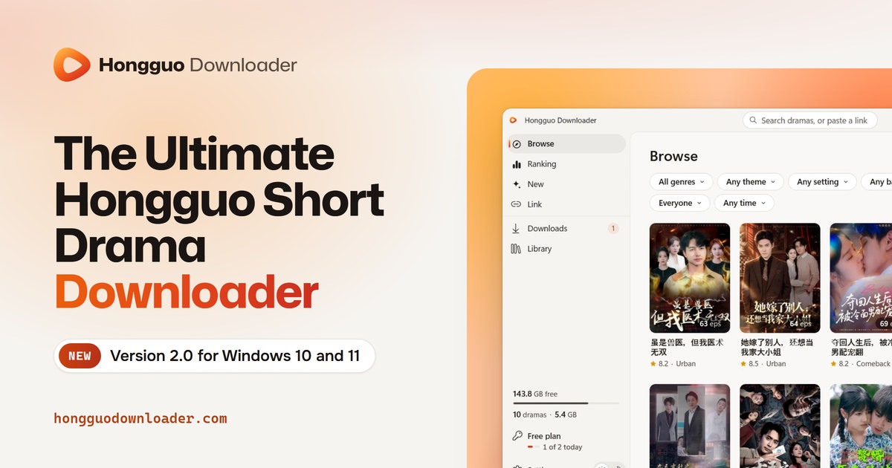</a>

 

## ✨ What's new in 2.0

**A new Hongguo Downloader, rebuilt for Windows 10 and 11.**

- 🔑 **Your key comes with you:** open the new app and your plan is active.
- 🎨 **A fresh look** in light and dark that follows your Windows theme.
- 🔎 **Browse, Ranking and New:** find dramas with filters and search, or paste a share link.
- 🎞️ **A series window** with every season and the sizes each series really comes in, with Play to watch.
- ⬇️ **Downloads in the original 1080p**, several series at once, with live progress and speed.
- ⚡ **Much faster downloads** that keep going when a connection stalls.
- 📚 **Your Library:** Play and Open folder on every cover, episodes that play straight from your PC with no internet, the new seasons of your dramas, and Select to delete several at once.
- ▶️ **A built-in player** right in the app window.
- 🎁 **Try it free:** 2 new series a day, and watch the first 5 episodes of every series.
- 💳 **Buy in the app** by card, PayPal, Google Pay or crypto. Your new key goes in by itself.
- 💾 **Save to a network drive (NAS)**, with the drive's own free space.
- 🔄 **It updates itself**, and you can report a bug from Settings › Help in one click.

<a href="https://github.com/M4St3r0/hongguo-downloader/releases/latest"><b>Release notes</b></a> &nbsp;·&nbsp; <a href="https://hongguodownloader.com/whatsnew/"><b>What's new on the website</b></a>

 

## 🧭 A tour of the app

### Browse: the whole 红果 catalogue

<picture>
  <source media="(prefers-color-scheme: dark)" srcset="https://raw.githubusercontent.com/M4St3r0/hongguo-downloader/main/assets/v2/browse-dark.webp">
  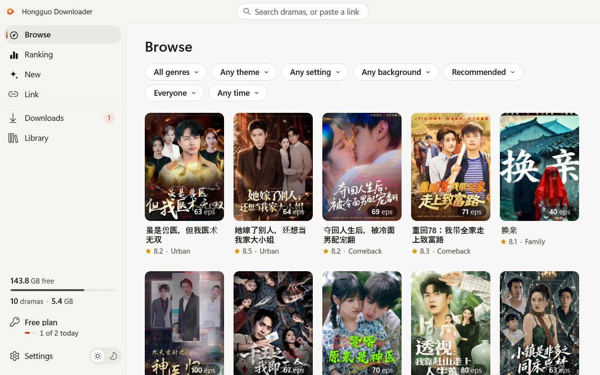
</picture>

- **Filters:** genre (Live action, Comic drama, AI drama), theme, setting and background, sort (Recommended, Newest, Hottest, Most saved), audience and release time.
- **Search** from the box at the top: type a title, or paste a link. <kbd>Ctrl</kbd>+<kbd>F</kbd> jumps there.
- Dramas you already have carry a **Downloaded** mark. Point at a cover for a one-click download of every episode.
- The left panel shows your **free space**, how many dramas you have and the space they take, and **today's free count**.

### Ranking and New

<table>
  <tr>
    <td width="50%" valign="top">
      <picture>
        <source media="(prefers-color-scheme: dark)" srcset="https://raw.githubusercontent.com/M4St3r0/hongguo-downloader/main/assets/v2/ranking-dark.webp">
        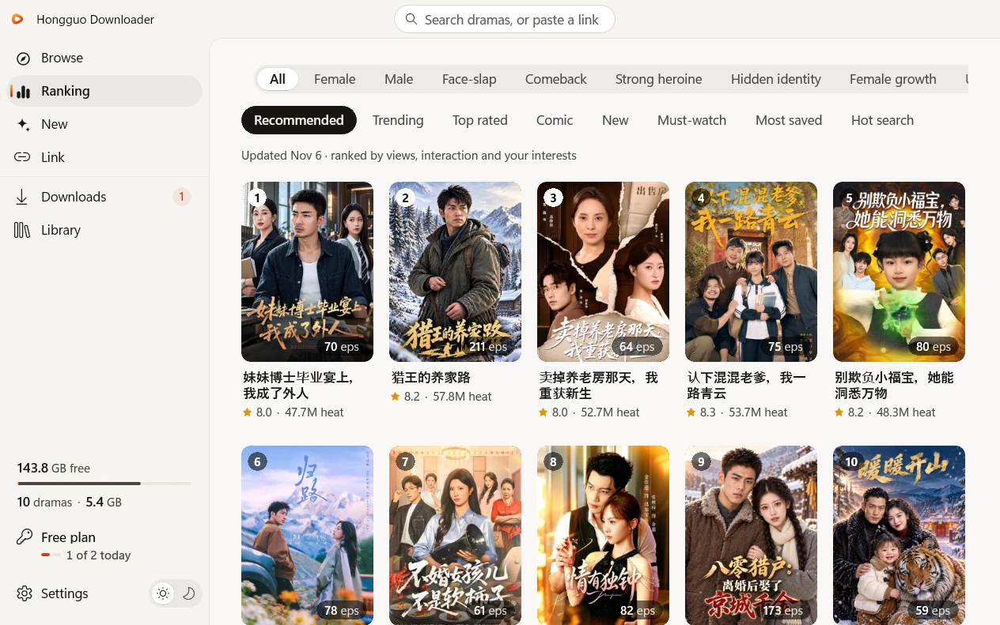
      </picture>
      
<b>Ranking:</b> Hongguo's own charts, such as Trending, Top rated and Hot search, on boards such as All, Female and Male.

    </td>
    <td width="50%" valign="top">
      <picture>
        <source media="(prefers-color-scheme: dark)" srcset="https://raw.githubusercontent.com/M4St3r0/hongguo-downloader/main/assets/v2/new-dark.webp">
        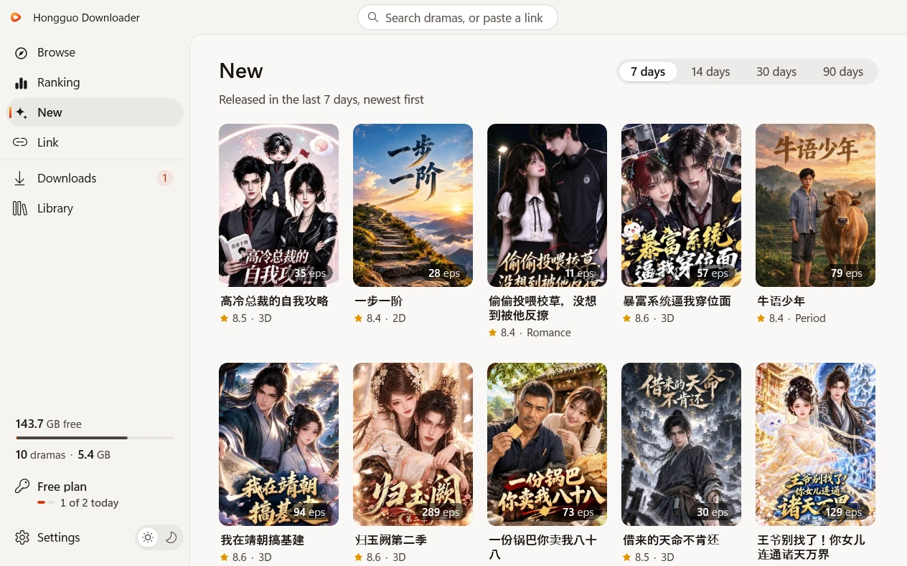
      </picture>
      
<b>New:</b> everything released in the last 7, 14, 30 or 90 days, newest first.

    </td>
  </tr>
</table>

### Link: paste a share link

Got a link from a friend? Open **Link**, paste it and press **Find series**. *"Paste share messages, links or series IDs. One or many, in any order."* Whole share messages work, and so do `hongguoduanju.com` and `novelquickapp.com` links. Open one series to pick episodes, or press **Download all** to take every series it found.

### The series window: seasons, sizes and episodes

<picture>
  <source media="(prefers-color-scheme: dark)" srcset="https://raw.githubusercontent.com/M4St3r0/hongguo-downloader/main/assets/v2/series-dark.webp">
  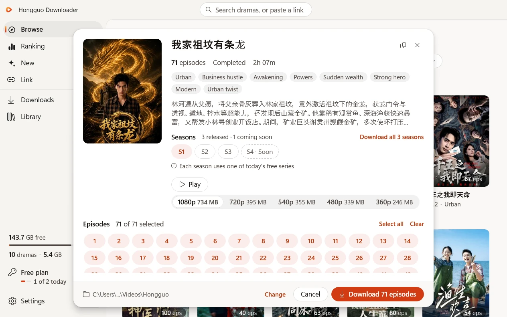
</picture>

- **Every season** of a series in one place, with one button for all of them, such as *Download all 3 seasons*. A season that's announced but not out yet shows *Soon*.
- **The sizes the series really comes in**, from 1080p down to 360p, with about how much space each one takes.
- **Every episode starts selected.** Take them all in one click, or press *Clear* and pick only the ones you want.
- **Play** to watch first, and **Change** to pick another save folder.

### Downloads: several series at once

<picture>
  <source media="(prefers-color-scheme: dark)" srcset="https://raw.githubusercontent.com/M4St3r0/hongguo-downloader/main/assets/v2/downloads-dark.webp">
  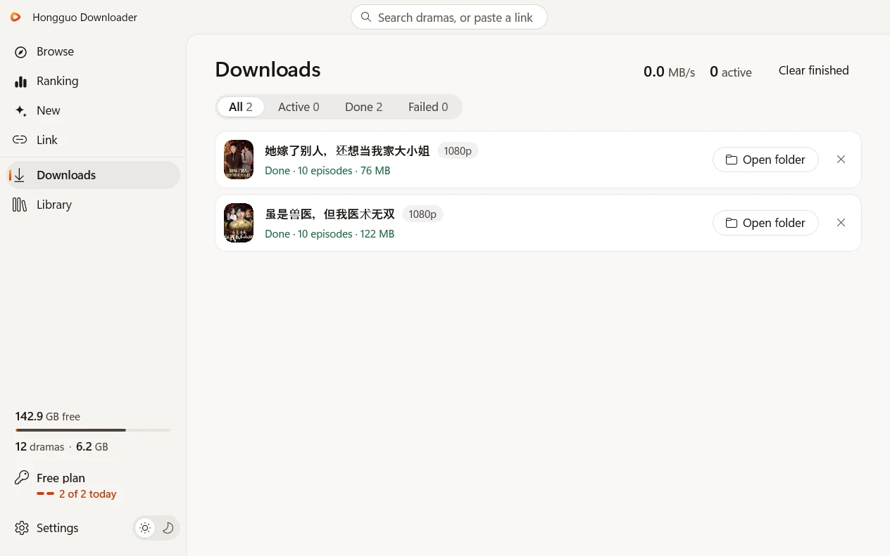
</picture>

- **The original 1080p** by default. A few episodes have no 1080p copy: those come in 720p, and Downloads tells you how many.
- **Several series at once**, each with its own live progress, speed and time left, plus the total at the top. *Settings › At once* sets how many.
- **Much faster**, and a slow or stuck connection is replaced at once, so downloads keep going.
- **Retry** a series that failed, **Stop all** (it asks first, and episodes already downloaded stay in their folders), and **Clear finished**.

### Library: everything you've saved

<picture>
  <source media="(prefers-color-scheme: dark)" srcset="https://raw.githubusercontent.com/M4St3r0/hongguo-downloader/main/assets/v2/library-dark.webp">
  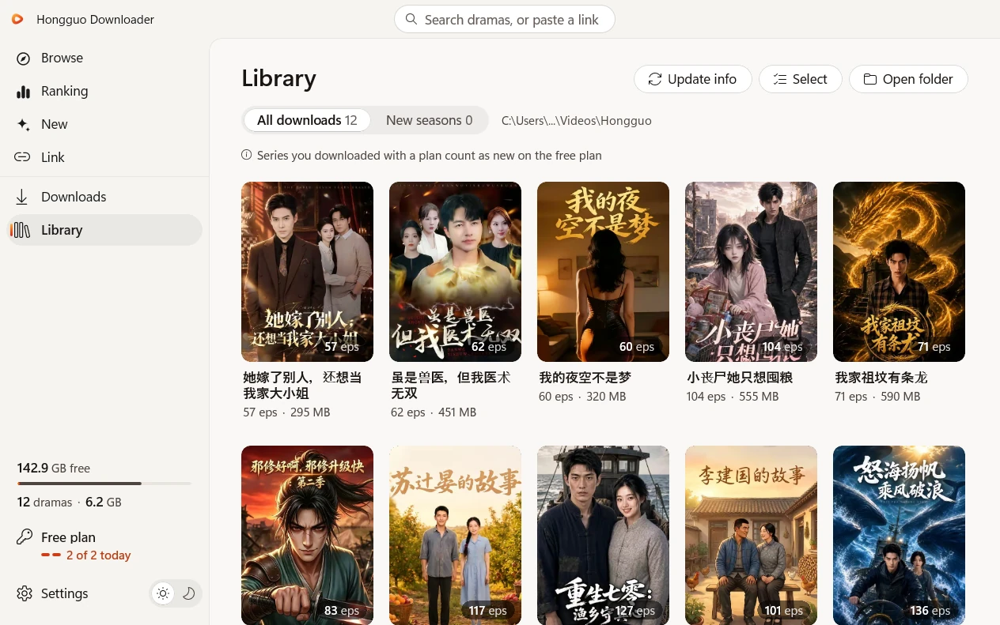
</picture>

- **Play** and **Open folder** on every cover. Downloaded episodes play straight from your PC, with no internet.
- **New seasons:** when a drama you have gets a new season, it shows up here, with **Download all new seasons**.
- **Select** several series and delete them at once. They go to the Recycle Bin, so you can bring them back (a network drive has no Recycle Bin, so there the app warns you that it's for good).

### The built-in player

<picture>
  <source media="(prefers-color-scheme: dark)" srcset="https://raw.githubusercontent.com/M4St3r0/hongguo-downloader/main/assets/v2/player-dark.webp">
  
</picture>

- Opens **right over the app window**, with the episode as big as the window allows.
- **Episodes**, Previous, Next, volume, speed, quality and full screen (<kbd>F</kbd>). <kbd>Esc</kbd> goes back.
- The controls **fade while you watch** and come back when you move the mouse.
- **Free:** episodes 1 to 5 of every series, as many series as you like. **With a key:** every episode.

### Account, plans and your key

<picture>
  <source media="(prefers-color-scheme: dark)" srcset="https://raw.githubusercontent.com/M4St3r0/hongguo-downloader/main/assets/v2/account-dark.webp">
  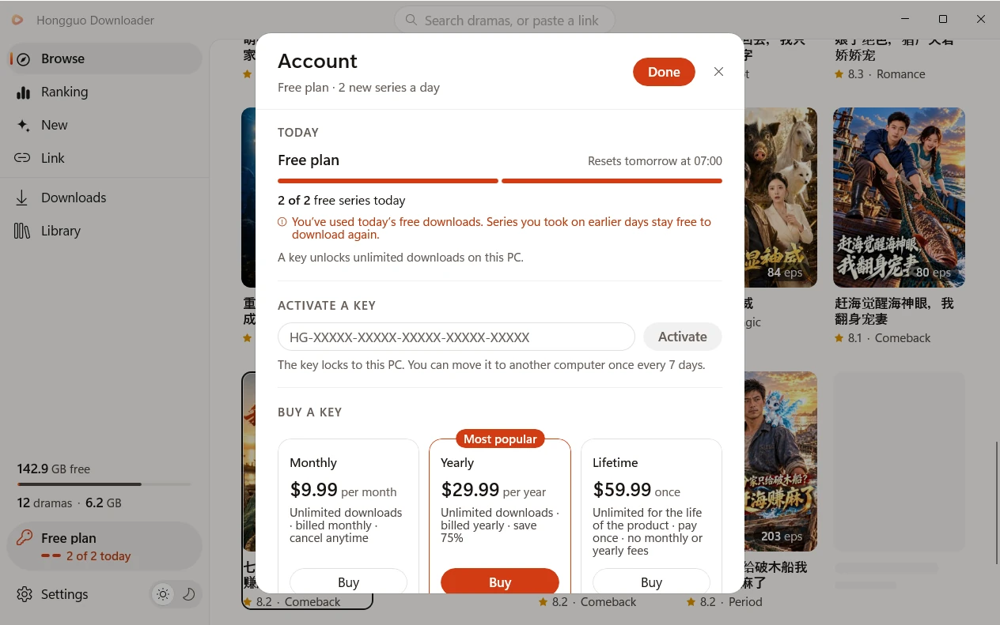
</picture>

- **Today's free count** and when it resets, in your own time.
- **Activate a key**, or **buy one right in the app**: checkout opens in your browser and the app never sees your card. Once the payment goes through, the app activates by itself.
- **Manage subscription** emails you a secure link to update your card, see invoices or cancel.
- **New PC?** Enter your key there and choose *Move to this PC*. A key can move once every 7 days.

 

## 🔍 2.0 up close

<table>
  <tr>
    <td width="50%" valign="top">
      <picture>
        <source media="(prefers-color-scheme: dark)" srcset="https://raw.githubusercontent.com/M4St3r0/hongguo-downloader/main/assets/v2/seasons-crop-dark.webp">
        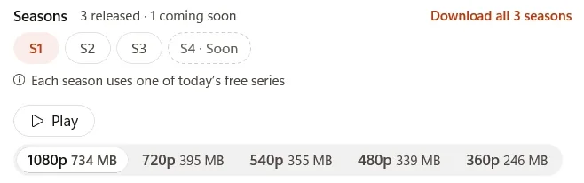
      </picture>
      
<b>Every season, real sizes.</b> See what each quality takes before you download.

    </td>
    <td width="50%" valign="top">
      <picture>
        <source media="(prefers-color-scheme: dark)" srcset="https://raw.githubusercontent.com/M4St3r0/hongguo-downloader/main/assets/v2/episodes-crop-dark.webp">
        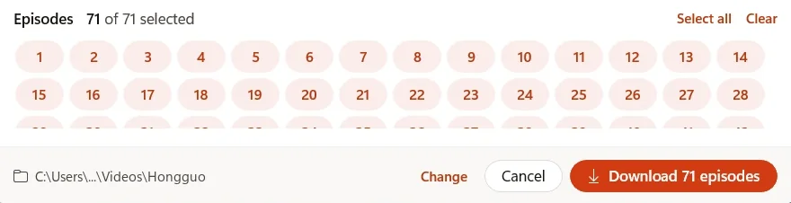
      </picture>
      
<b>The whole series, or only the episodes you pick.</b>

    </td>
  </tr>
  <tr>
    <td width="50%" valign="top">
      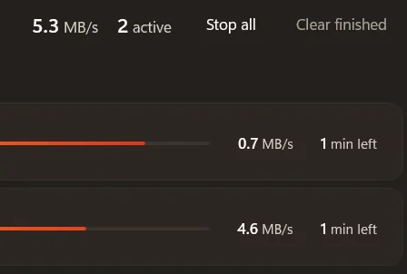
      
<b>Several series at once,</b> with the total speed and Stop all at the top.

    </td>
    <td width="50%" valign="top">
      <picture>
        <source media="(prefers-color-scheme: dark)" srcset="https://raw.githubusercontent.com/M4St3r0/hongguo-downloader/main/assets/v2/player-crop-dark.webp">
        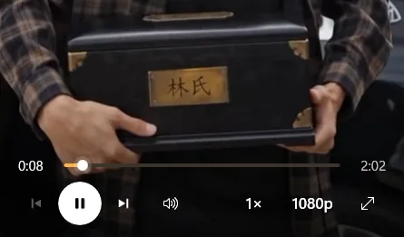
      </picture>
      
<b>A player built right in,</b> with every control one click away.

    </td>
  </tr>
</table>

 

## 🚀 How it works

| | | |
|:-:|:--|:--|
| **1** | **Install** | [Download Setup](https://github.com/M4St3r0/hongguo-downloader/releases/latest/download/HongguoDownloader-Setup.exe) (158.6 MB) and run it. It installs for your Windows account, with no administrator rights, and opens the app. |
| **2** | **Find a drama** | Browse with filters, search by title, check Ranking or New, or paste a share link into Link. |
| **3** | **Pick episodes and quality** | Every episode starts selected. Pick a quality: the window shows how much space it takes. |
| **4** | **Download and watch** | Every episode saves as an MP4 file (named like `S01E001.mp4`) in `Videos\Hongguo`, one folder per series, and plays in the built-in player, even offline. |

 

## 💎 Free and paid plans

| | **Free** | **Monthly** | **Yearly** ⭐ *Most popular* | **Lifetime** |
|:--|:-:|:-:|:-:|:-:|
| **Price** | **$0** | **$9.99** a month | **$29.99** a year | **$59.99** once |
| **New series** | 2 a day, every episode | Unlimited | Unlimited | Unlimited |
| **Watch in the player** | Episodes 1 to 5 of every series | Every episode | Every episode | Every episode |
| **Good to know** | No card, no account | Cancel any time | About $2.50 a month, save 75% vs Monthly | For the life of the product |

Prices in US dollars. Pay by card, PayPal, Google Pay or crypto. On the free plan each season counts as its own series, a series you started stays free to finish, and the count resets every day at 00:00 UTC. One key works on one PC at a time: move it to a new PC yourself, once every 7 days. Monthly and Yearly renew until you cancel. All sales are final, except where the law requires a refund (<a href="https://hongguodownloader.com/refund-policy/">refund policy</a> · <a href="https://hongguodownloader.com/terms/">terms</a> · <a href="https://hongguodownloader.com/privacy/">privacy</a>).

 

## 🔁 Coming from version 1?

1. Close version 1.
2. Install 2.0 on the same PC and open it, signed in to the same Windows account, with the internet on.
3. Your key comes with you and your plan is active. After 2.0 opens, you can uninstall the old version.

 

## 💻 Requirements

- **Windows 10** (version 2004 or newer) or **Windows 11**, 64-bit
- **Setup is 158.6 MB**, installs for your Windows user and needs no administrator rights
- **Nothing else to install:** Setup brings everything the app needs, with no emulator and no account
- **An internet connection** to browse and download. Downloaded episodes play offline.

> 💡 **First install:** Windows may show a blue *"Windows protected your PC"* screen. It's SmartScreen's reputation check for apps few people have run yet, not a virus warning. Click **More info**, check that the file is `HongguoDownloader-Setup.exe`, then click **Run anyway**. [Step-by-step guide →](https://hongguodownloader.com/blog/fix-windows-protected-your-pc-hongguo-downloader/)

 

## ❓ FAQ

<b>Is it really free?</b>

 
Yes. The free plan downloads 2 new series a day, every episode of both, with no card and no account. You can also watch episodes 1 to 5 of any series in the app's player. Paid plans remove the daily limit.

<b>Where are my files saved?</b>

 
In <code>Videos\Hongguo</code> unless you pick another folder, with a folder for each series and every episode as an MP4 file named like <code>S01E001.mp4</code>. Settings also offers <code>第001集</code> and <code>Episode 001</code> names, and you can change the folder any time, a network drive (NAS) included.

<b>Can I watch without the internet?</b>

 
Yes. Episodes you've downloaded play straight from your PC in the built-in player. Browsing, downloading and the free plan need a connection, and a paid plan checks in online at least once every 72 hours.

<b>Are the downloads really 1080p?</b>

 
Downloads come in the original 1080p. A few episodes have no 1080p copy: those come in 720p, and Downloads tells you how many. You can also pick a smaller size to save space.

<b>How do I move my key to a new PC?</b>

 
Enter your key in Account on the new PC and choose <i>Move to this PC</i>: the old PC stops using it at its next check. A key can move once every 7 days, and from a new PC up to 4 times a year. After that, email support.

<b>Does it work on Mac?</b>

 
No. Hongguo Downloader is a Windows app, for Windows 10 (version 2004 or newer) and Windows 11, 64-bit.

<b>Is it affiliated with 红果 / Hongguo?</b>

 
No. Hongguo Downloader is an independent app made by FireCode LLC, not affiliated with 红果 / Hongguo, hongguoduanju or ByteDance. It's for personal, offline viewing: please respect creators' rights.

 

## 📖 Guides

- [**What is Hongguo Downloader?**](https://hongguodownloader.com/blog/what-is-hongguo-downloader/) Every 2.0 screen, in order.
- [**How to download Hongguo short dramas to your PC**](https://hongguodownloader.com/blog/how-to-download-hongguo-short-dramas-to-pc/) Your first download, step by step.
- [**Fix "Windows protected your PC"**](https://hongguodownloader.com/blog/fix-windows-protected-your-pc-hongguo-downloader/) Install safely, past SmartScreen.
- [**All guides**](https://hongguodownloader.com/blog/)

## 💬 Help

- **Telegram:** [@HongguoDownloaderBot](https://t.me/HongguoDownloaderBot) or [@M4st3r0](https://t.me/M4st3r0)
- **Email:** [support@hongguodownloader.com](mailto:support@hongguodownloader.com)
- **In the app:** *Settings › Help › Report a bug* saves a report (your key and Windows user name stay hidden), copies a short summary and opens our Telegram, ready to send.

 

<a href="https://hongguodownloader.com">Website</a> &nbsp;·&nbsp; <a href="https://hongguodownloader.com/whatsnew/">What's new</a> &nbsp;·&nbsp; <a href="https://hongguodownloader.com/blog/">Guides</a> &nbsp;·&nbsp; <a href="https://hongguodownloader.com/zh/">中文</a> &nbsp;·&nbsp; <a href="https://t.me/HongguoDownloaderBot">Telegram</a> &nbsp;·&nbsp; <a href="https://www.youtube.com/@hongguodownloader">YouTube</a> &nbsp;·&nbsp; <a href="https://www.facebook.com/hongguodownloader/">Facebook</a>

Hongguo Downloader is made by <a href="https://firecodellc.app">FireCode LLC</a>. Not affiliated with 红果 / Hongguo, hongguoduanju or ByteDance. For personal use; please respect creators' rights.

